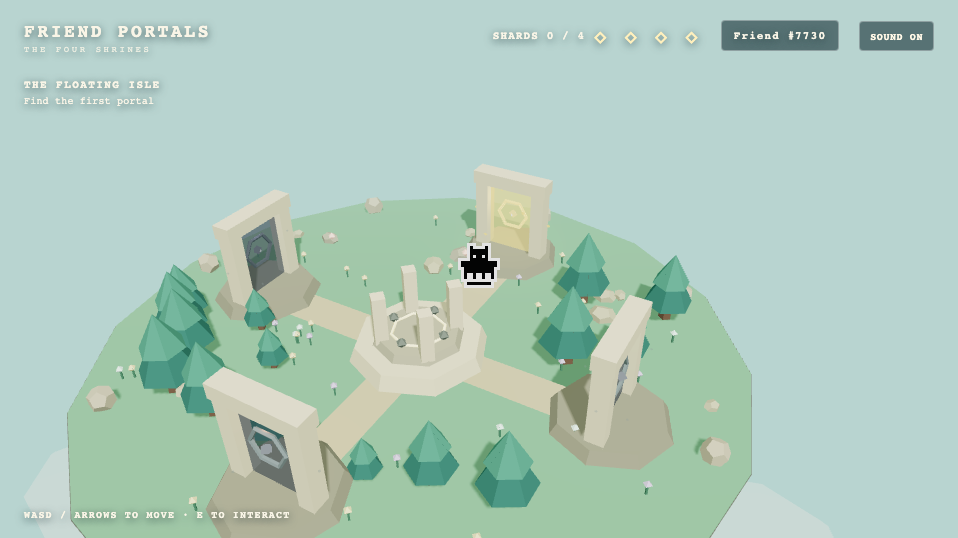

# Friend Portals

A replayable 3D Rare Friends puzzle adventure built for the Rare Friends Vibeathon. Guide your wallet-selected Rare Friend across a floating island, restore four portals, and awaken its central monument.



## Play

The public GitHub Pages link will be added after the first deployment. To enter, connect a browser wallet holding an eligible Rare Friends Generations NFT (generation 1 or higher) on Robinhood mainnet (chain 4663), then choose your Friend. No RF funding or transaction signature is needed for this simulated preview.

## Journey

Temple of Light → Echo Garden → Temple of Balance → Celestial Observatory → Restoration.

The four worlds use light routing, movement and musical memory, movable weights, and timed celestial alignment. Claim a shard in each world, return to the island, and activate the monument to reveal a Journey Sigil. **Explore Restored Island** keeps the completed world open; **New Journey** starts again with a new seed. Puzzle answers and selected island cosmetics vary between journeys while each journey stays deterministic.

The playable character uses the selected Friend's canonical animated 2D artwork inside the 3D world. FriendSDK handles wallet connection, eligible ownership and Friend selection. No NFT minting, token rewards, purchases or blockchain writes are part of the game.

## Controls

- **Desktop:** WASD or arrow keys move; E or Space interacts; R resets the current unsolved Light, Balance or Celestial puzzle. Step on Echo Runes to activate them.
- **Touch:** Use the movement joystick and ACTION button. Echo Runes activate on entry. An on-screen reset control is available where needed; landscape is recommended.
- **Sound:** Use the SOUND button to mute. Reduced-motion preferences are supported.

## Tech

TypeScript, React, Three.js, React Three Fiber and **FriendSDK v0.1.3**. The SDK's trusted host provides the wallet and selected Friend on Robinhood Chain; its public sprite and sound APIs provide canonical character frames and selected cues. The island, puzzles and most effects/audio are original procedural assets. The static site is built with the FriendSDK CLI, without Vite or a backend.

## Development

Node.js 22+ is required. The exact FriendSDK v0.1.3 package archive is included in `vendor/`.

```sh
npm ci
npm run dev
```

## Validation

```sh
npm run typecheck
npm run test:seed
npm run test:balance
npm run test:celestial
npm run test:finale
npm run test:friend
npm run check
npm run build
npm run test:browser
npm run test:slice
```

`npm run check` and `npm run build` invoke FriendSDK v0.1.3. The complete static build is generated in `.friendsdk/`. The Pages workflow uploads that entire directory. Browser tests use SDK mock wallet and RPC responses; they do not prove real-wallet play.

## Current limitation

Progress is session-only. Refreshing the page starts a new session because the current SDK sandbox has no supported save bridge.

## Credits

Canonical Friend artwork and selected sound cues: Rare Friends / FriendSDK. All other game geometry, symbols, puzzle logic, effects and procedural cues were created for Friend Portals. This is an independent Rare Friends Vibeathon submission; official publication through Rare Friends would require separate review.
